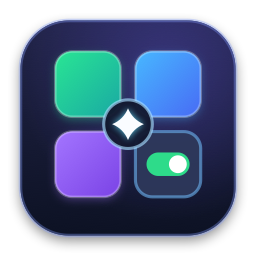

<div align="center">
  
  <h1>Apollo SkillHub</h1>
  <p><strong>Native macOS Unified AI Skill Manager for Antigravity, Codex & Claude Code</strong></p>
  <p>原生 macOS 跨端 AI Skill 统一管理中枢 · 固定仓库 + 三端软链接热同步</p>
</div>

---

## ✨ 核心特性 (Features)

- **固定仓库 + 自动归档**：所有本地 Skill 统一存储于可自定义的固定目录（默认 `~/.agents/skills-vault`），彻底告别多工具目录分散拷贝。点击顶部 **「↻ 扫描刷新」** 可自动将命令行 / GitHub 新装到外部目录的 Skill 归入固定仓库并建立软链接。
- **三端独立精准控制**：基于「中央技能金库 + 软链接矩阵」，一键独立切换每个 Skill 在 **Antigravity (`AGY`)、Codex、Claude Code** 中的启用状态，未安装的工具自动按需惰性创建目录，不产生冗余文件。
- **清爽可折叠卡片 + iOS 滑动开关**：
  - 默认收起态单行呈现核心信息，主表行右侧直接配备 **iOS 风格滑动开关** 一键启停；
  - 点击卡片或「详情」平滑展开完整介绍、自动提取的触发词标签、三端独立开关、所属分类下拉框及 `SKILL.md` / 访达定位入口。
- **左侧分类管理 + 顶部横向平台筛选**：
  - 左侧边栏支持新建分类、行内重命名、带二次确认弹窗的删除分类；
  - 右侧顶部横向按平台筛选（`全部平台 / Antigravity / Codex / Claude`）及按分类一键 `全开 / 全关`。
- **独立居中导入弹窗**：支持输入 GitHub 仓库（`owner/repo` 或完整 URL）一键克隆校验安装，或直接导入本地 Skill 文件夹到固定仓库，绝不遮挡/挤压技能列表。

---

## 📦 安装方式 (Installation)

### 方式一：通过 Releases DMG 安装（推荐）
1. 在 [Releases](../../releases) 页面下载最新的 **`Apollo-SkillHub-1.0.0.dmg`**。
2. 双击挂载 DMG 镜像，将 **`Apollo SkillHub.app`** 拖入 **`Applications`** 文件夹。
3. 从「应用程序」或启动台打开即可使用。

> **提示**：如首次打开未公证的开源应用提示安全拦截，可在终端运行：
> ```bash
> xattr -cr "/Applications/Apollo SkillHub.app"
> ```

### 方式二：从源码编译 (Build from Source)
单文件纯原生 AppKit + SwiftUI 实现，无需 Xcode 工程：
```bash
# 1. 生成多分辨率图标 AppIcon.icns
swift generate_icon.swift

# 2. 编译 Apple Silicon 原生二进制
swiftc -O -framework AppKit -framework SwiftUI ApolloSkillHub.swift -o "Apollo SkillHub.app/Contents/MacOS/ApolloSkillHub"
```

---

## 🔗 相关开源项目

- **[Apollo-AgentMeter](https://github.com/lingqiushi001-git/Apollo-AgentMeter)** — 原生 macOS 状态栏 AI 剩余额度与重置倒计时实时监控工具

---

## 📄 开源协议 (License)

MIT License © 2026 Apollo
